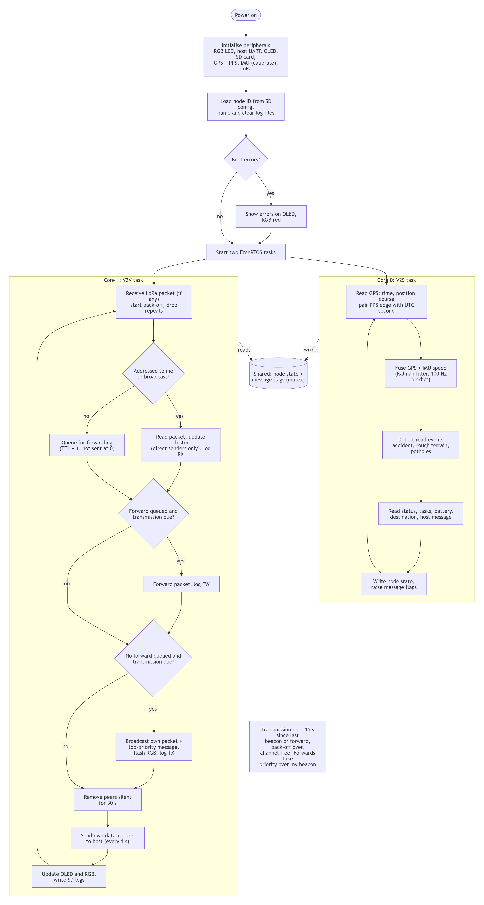

# TUKZIE V2X VANET (TVV)

A vehicle-to-everything (V2X) vehicular ad hoc network (VANET) built on LoRa. Each vehicle carries a **TVV node**: an ESP32-S3 board that senses its own position, speed and road conditions, broadcasts them to nearby nodes, and keeps a table of the peers it can hear. The node also exchanges data with the vehicle's onboard **host** (for example, the TUKZIE dashboard) over UART.



## Features

- **LoRa network:** 433 MHz, SF7, 25-byte binary beacons every 15 s, broadcast or addressed to one node (provision for destination-based routing), with a CSMA/CA-style MAC (carrier sense plus a random back-off after each received packet).
- **Link quality:** each beacon carries a sequence number (gaps = lost packets) and the sender's channel RSSI; the receiver also records the packet's RSSI and SNR.
- **Cluster of peers:** up to 3 peers, refreshed on every packet and dropped after 10 s of silence.
- **Sensor fusion:** GPS speed (1 Hz) and IMU acceleration (100 Hz) fused by a 2-state Kalman filter, with stop detection and zero-velocity updates.
- **Road awareness:** detects accidents (toppled over, or spinning), rough terrain and potholes from the IMU, and low battery from the host. The highest-priority event goes out with each beacon, and a message from the host goes out before all of them.
- **Host link:** sends the node and its cluster to the host every second, and receives the node's status, number of tasks, battery level, beacon destination and a host message.
- **Dual-core:** sensing runs on core 0, networking and the user interface on core 1 (FreeRTOS), with mutex-protected shared state.
- **On-node UI:** a 128×64 OLED shows signal bars (average SNR of the peers), speed, battery, status, position, peers and the latest peer message. An RGB LED flashes the colour of each message sent.
- **SD card logs:** VANET Rx/Tx, the node's own data and sensing, written to fresh files on every boot (`config.txt` is kept).

## Repository layout

| Path | Contents |
|---|---|
| [`firmware/`](firmware) | PlatformIO project for the node (ESP32-S3, Arduino + FreeRTOS) |
| [`firmware/src/`](firmware/src) | Firmware sources (see [Firmware modules](#firmware-modules)) |
| [`firmware/include/`](firmware/include) | Headers, including all pins and settings in `system.h` |
| [`firmware/lib/`](firmware/lib) | Local libraries: patched `LoRa` and `SparkFun_LSM6DS3` |
| [`firmware/docs/`](firmware/docs) | UML and flow diagrams (Mermaid source and PNG exports) |
| [`case/`](case) | FreeCAD enclosure models and STL exports (`v1` to `v3`, latest in `v3/`) |
| [`misc/`](misc) | Legacy code and standalone test sketches |

## Hardware

| Part | Interface | Pins (ESP32-S3) |
|---|---|---|
| 4D Systems gen4 ESP32-S3 R8N16 | | |
| LoRa radio (SX127x, 433 MHz) | SPI (HSPI) | SCK 39, MISO 40, MOSI 41, NSS 42, RST 38, DIO0 21 |
| GPS (NMEA, 9600 baud) | UART1 | RX 17, TX 18 |
| IMU (LSM6) | I2C (`Wire1`) | SDA 8, SCL 9 |
| OLED SSD1306 128×64 @ 0x3C | I2C (`Wire`) | SDA 4, SCL 5 |
| microSD card | SPI (FSPI) | CS 10, MOSI 11, SCK 12, MISO 13 |
| RGB LED (NeoPixel) | GPIO | 48 |
| Host | UART2, 115200 baud | RX 1, TX 2 |
| Debug serial | UART0 (CH343 USB-UART), 115200 baud | |

All pins and settings are defined in [`include/system.h`](firmware/include/system.h).

## Getting started

1. Install [PlatformIO](https://platformio.org/) (the VS Code extension or the CLI).
2. Prepare a microSD card with `/config.txt` holding the node ID (1 to 255), e.g.:
   ```
   7
   ```
   Every node needs a unique ID.
3. Build and flash from the `firmware` folder:
   ```bash
   pio run -t upload
   ```
4. Open the serial monitor (115200 baud):
   ```bash
   pio device monitor
   ```

During boot the OLED shows each peripheral's init result, and the RGB LED blinks green (pass) or red (fail). Keep the node still while it boots, because the IMU calibrates then.

## Firmware modules

| File | Responsibility |
|---|---|
| `main.cpp` | Boot sequence, and the two FreeRTOS tasks: `sensingLoop` (core 0) and `networkLoop` (core 1) |
| `system.cpp` | Shared `Data` struct (the node's own state `myself`), error reporting |
| `sensing.cpp` | `GPS`, `IMU`, `KalmanFilter` and `SpeedFilter` (GPS + IMU speed fusion) |
| `interpret.cpp` | Coded messages and statuses, accident, terrain and battery detection, message priority |
| `vanet.cpp` | LoRa radio, `Packet` packing, MAC (back-off, carrier sense), `Cluster` of peers |
| `host.cpp` | UART link to the host |
| `display.cpp` | OLED node view and RGB LED |
| `storage.cpp` | SD card: node config and log files |
| `diagnostics.cpp` | Per-peripheral debug routines and log line formatting |

Detailed diagrams are in [`firmware/docs/firmware-diagrams.md`](firmware/docs/firmware-diagrams.md):

| Diagram | PNG |
|---|---|
| UML class diagram | [1-class-diagram.png](firmware/docs/1-class-diagram.png) |
| UML sequence diagram (dual-core runtime) | [2-sequence-diagram.png](firmware/docs/2-sequence-diagram.png) |
| UML state diagram (MAC) | [3-mac-state-diagram.png](firmware/docs/3-mac-state-diagram.png) |
| Boot flow | [4-flow-boot.png](firmware/docs/4-flow-boot.png) |
| Sensing task flow | [5-flow-sensing-task.png](firmware/docs/5-flow-sensing-task.png) |
| Network task flow | [6-flow-network-task.png](firmware/docs/6-flow-network-task.png) |
| Speed fusion flow | [7-flow-speed-fusion.png](firmware/docs/7-flow-speed-fusion.png) |
| Road awareness flow | [8-flow-road-awareness.png](firmware/docs/8-flow-road-awareness.png) |
| Overview flow | [9-flow-overview.png](firmware/docs/9-flow-overview.png) |

## Protocols

### LoRa packet (25 bytes)

| dest | src | seq | rssi | message | date | time | lat | lon | status | tasks | battery |
|---|---|---|---|---|---|---|---|---|---|---|---|
| 1 | 1 | 2 | 1 | 1 | 4 | 4 | 4 | 4 | 1 | 1 | 1 |

- `dest`: destination node ID, `0` = broadcast. A node only reads packets addressed to it or broadcast. A non-zero `dest` hides the sender from every other node's cluster.
- `seq`: the sender's beacon count, incremented on every beacon sent (wraps at 65535). Gaps show lost packets.
- `rssi`: the sender's `LoRa.rssi()` in dBm just before it sent, i.e. the channel noise level at the sender.

Latitude and longitude are sent as scaled integers (× 10⁷), and battery as a whole percentage. Altitude, speed and course are not sent, so they read 0 for peers. Date is `DDMMYY` and time is `HHMMSSCC`, both in SAST (UTC+2). Radio settings: 433.2125 MHz, BW 125 kHz, SF7, CR 4/5, sync word `0x12`, 10 dBm, CRC on.

### Host link (UART2, text)

| Direction | Format |
|---|---|
| Node → host (every 1 s) | `$<node>\n` for the node itself, then one line per cluster peer |
| Host → node | `$status,tasks,battery,dest,message\n` (all 5 fields required) |

`<node>` is `date,time,lat,lon,alt,speed,course,status,tasks,battery,message,seq,srcRssi,pktRssi`:

- `seq`: the node's last beacon sequence number.
- `srcRssi`: that node's channel RSSI (dBm) sent in its beacon.
- `pktRssi`: how strongly this node received that node's last packet (dBm), `0` for the node itself.

Host → node `message` is `0` (no change) or `5` (host message, sent once in the next beacon before any other message). `dest` sets the destination of the node's beacons, normally `0`. Battery is only known while a host is connected (a valid packet within 10 s).

### Coded messages and statuses

| Code | Message | RGB flash | | Code | Status |
|---|---|---|---|---|---|
| 0 | None | Green | | 0 | Parked |
| 1 | Met with accident | Red | | 1 | Charging |
| 2 | Low on battery (≤ 50 %) | Purple | | 2 | Delivering |
| 3 | Rough terrain is present | Orange | | 3 | Taxi |
| 4 | Potholes are present | Yellow | | | |
| 5 | My host message (from the host) | Blue | | | |

A lower message code has a higher priority, except the host message (5), which is always sent first. Each beacon carries the highest-priority pending message.

## Debugging

Set `debugMode = true` in `main.cpp` and uncomment one `debug(DBG_...)` call in `loop()` to test a single peripheral (OLED, SD card, GPS, IMU, host loopback, LoRa Rx/Tx). In debug mode the FreeRTOS tasks are not started.

## Status

Work in progress (version 0):

- SD card logs (`log.txt`, `node.txt`, `sensing.txt`, `debug.txt`) are deleted at every boot, so copy them off before powering a node again.
- All nodes must run the same firmware: nodes with a different packet size ignore each other.

## Author

Sharaav Dhebideen
