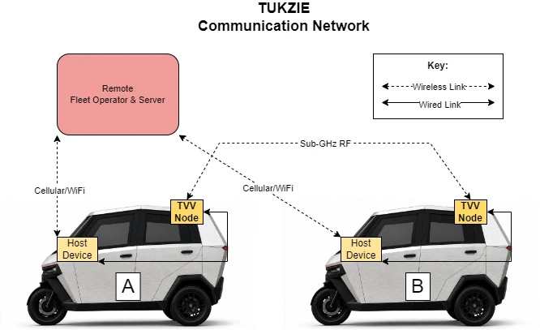
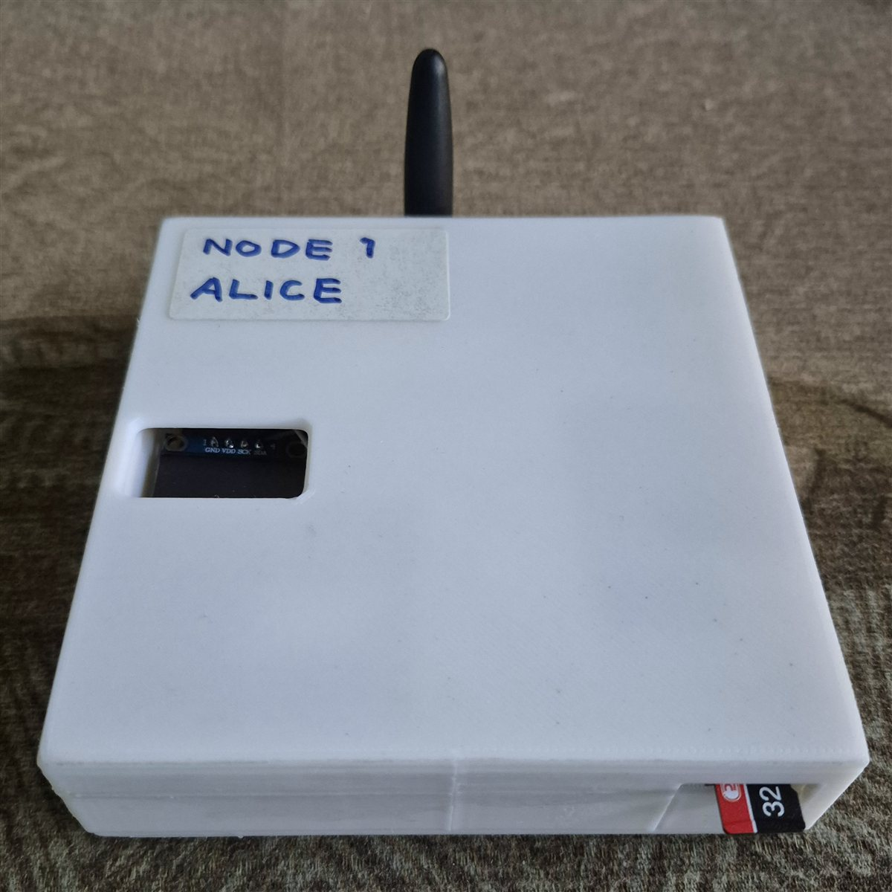
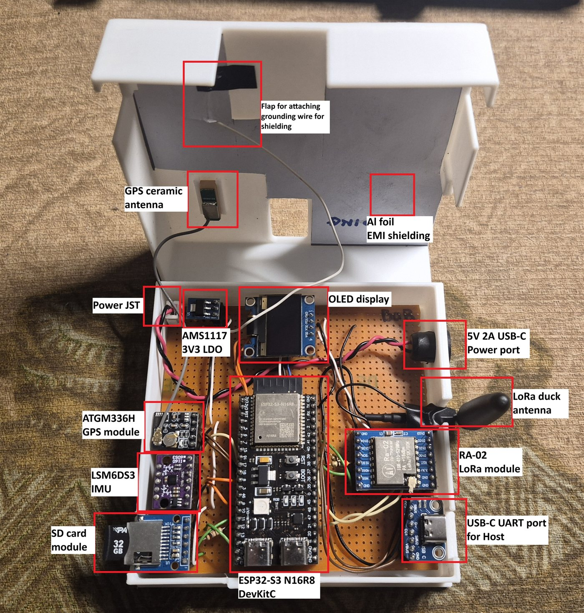
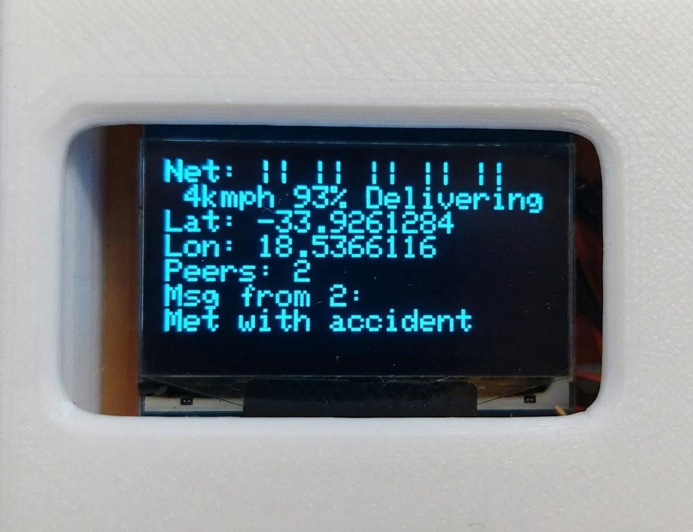

<p align="center"></p>

# TUKZIE V2X VANET (TVV)

A vehicle-to-everything (V2X) vehicular ad hoc network (VANET) built on LoRa. Each vehicle carries a **TVV node**: an ESP32-S3 board that senses its own position, speed and road conditions, broadcasts them to nearby nodes, and keeps a table of the peers it can hear. The node also exchanges data with the vehicle's onboard **host** (for example, the TUKZIE dashboard) over UART.

<p align="center"></p>

## Features

- **LoRa network:** 433 MHz, SF12, 25-byte binary beacons every 15 s, broadcast or addressed to one node (provision for destination-based routing), with a CSMA/CA-style MAC (carrier sense plus a random back-off after each received packet).
- **Link quality:** each beacon carries a sequence number (gaps = lost packets); the receiver records the packet's RSSI and SNR, and the sender logs its own channel RSSI before each beacon.
- **Forwarding:** a packet addressed to another node (not broadcast) is sent on unchanged (same sender and sequence number) with its TTL decremented, so a node the sender cannot reach still gets it (hidden terminal problem). TTL starts at 2, so a packet is forwarded at most once.
- **Cluster of peers:** up to 3 peers, refreshed on every packet and dropped after 30 s of silence.
- **Sensor fusion:** GPS speed (1 Hz) and IMU acceleration (100 Hz) fused by a 2-state Kalman filter, with stop detection and zero-velocity updates.
- **Road awareness:** detects accidents (a sharp impact of 7 g or more, or lying toppled for 10 s), bad terrain from the IMU (a bump, pothole or rough surface: a vertical jolt of 0.8 g or more either way, only while moving), and low battery from the host. The highest-priority event goes out with each beacon, and a message from the host goes out before all of them.
- **Host link:** sends the node and its cluster to the host every second, and receives the node's status, number of tasks, battery level, beacon destination and a host message.
- **Dual-core:** sensing runs on core 0, networking and the user interface on core 1 (FreeRTOS), with mutex-protected shared state.
- **On-node UI:** a 128×64 OLED shows signal bars (average SNR of the peers), speed, battery, status, position, peers and the latest peer message. An RGB LED flashes green on each beacon sent (blue when it carries the host message). Between flashes it shows what is detected right now (each colour held for 200 ms after its condition was last seen), in message priority: red during an accident, purple while the battery is low, orange during bad terrain, then yellow while there is no GPS fix.
- **SD card logs:** VANET Rx/Tx, the node's own data and sensing, written to fresh files on every boot (`config.txt` is kept).

## Repository layout

| Path | Contents |
|---|---|
| [`firmware/`](firmware) | PlatformIO project for the node (ESP32-S3, Arduino + FreeRTOS) |
| [`firmware/src/`](firmware/src) | Firmware sources (see [Firmware modules](#firmware-modules)) |
| [`firmware/include/`](firmware/include) | Headers, including all pins and settings in `system.h` |
| [`firmware/lib/`](firmware/lib) | Local libraries: patched `LoRa` and `SparkFun_LSM6DS3` |
| [`firmware/docs/`](firmware/docs) | UML and flow diagrams (Mermaid source and PNG exports), and the TVV user manual |
| [`simulation/host/`](simulation/host) | PlatformIO project for the simulated host device (SHD), see its [README](simulation/host/README.md) |
| [`simulation/omnet/`](simulation/omnet) | OMNeT++ model of the node's MAC and routing, with its simulation guide |
| [`tests/`](tests) | Field and component test logs, photos and plots, and the analysis script `test_analysis.m` |
| [`schematics/`](schematics) | KiCad schematic of the node |
| [`parts/`](parts) | Datasheets and enclosure models |
| [`misc/`](misc) | LoRa airtime calculator and a standalone GPS sketch |
| [`images/`](images) | Images used in this README |

## Hardware

<p align="center">
  
  
</p>

| Part | Interface | Pins (ESP32-S3) |
|---|---|---|
| 4D Systems gen4 ESP32-S3 R8N16 | | |
| LoRa radio (SX127x, 433 MHz) | SPI (HSPI) | SCK 39, MISO 40, MOSI 41, NSS 42, RST 38, DIO0 21 |
| GPS (NMEA, 9600 baud) | UART1 | RX 17, TX 18, PPS 16 |
| IMU (LSM6) | I2C (`Wire1`) | SDA 8, SCL 9 |
| OLED SSD1306 128×64 @ 0x3C | I2C (`Wire`) | SDA 4, SCL 5 |
| microSD card | SPI (FSPI) | CS 10, MOSI 11, SCK 12, MISO 13 |
| RGB LED (NeoPixel) | GPIO | 48 |
| Host | UART2, 115200 baud | RX 1, TX 2 |
| Debug serial | UART0 (CH343 USB-UART), 115200 baud | |

All pins and settings are defined in [`include/system.h`](firmware/include/system.h).

## Getting started

1. Install [PlatformIO](https://platformio.org/) (the VS Code extension or the CLI).
2. Prepare a microSD card with `/config.txt` holding the node ID (1 to 255), e.g.:
   ```
   7
   ```
   Every node needs a unique ID.
3. Build and flash from the `firmware` folder:
   ```bash
   pio run -t upload
   ```
4. Open the serial monitor (115200 baud):
   ```bash
   pio device monitor
   ```

At power-on the RGB LED lights white. During boot the OLED shows each peripheral's init result, and the RGB LED blinks green (pass) or red (fail). Keep the node still while it boots, because the IMU calibrates then.

After boot the OLED shows the node view: signal bars, speed, battery and status, position, peers and the latest peer message.

<p align="center"></p>

The full operating instructions are in the [TVV user manual](firmware/docs/TVV_user_manual.docx).

## Firmware modules

| File | Responsibility |
|---|---|
| `main.cpp` | Boot sequence, and the two FreeRTOS tasks: `v2sLoop` (core 0) and `v2vLoop` (core 1) |
| `system.cpp` | Shared `Data` struct (the node's own state `myself`), error reporting |
| `sensing.cpp` | `GPS`, `IMU`, `KalmanFilter` and `SpeedFilter` (GPS + IMU speed fusion) |
| `interpret.cpp` | Coded messages and statuses, accident, terrain and battery detection, message priority |
| `vanet.cpp` | LoRa radio, `Packet` packing, MAC (back-off, carrier sense), `Cluster` of peers |
| `host.cpp` | UART link to the host |
| `ui.cpp` | OLED node view and RGB LED |
| `storage.cpp` | SD card: node config, log files and log line formatting |
| `debugging.cpp` | Per-peripheral debug routines |

Detailed diagrams are in [`firmware/docs/firmware-diagrams.md`](firmware/docs/firmware-diagrams.md):

| Diagram | PNG |
|---|---|
| UML class diagram | [1-class-diagram.png](firmware/docs/1-class-diagram.png) |
| UML sequence diagram (dual-core runtime) | [2-sequence-diagram.png](firmware/docs/2-sequence-diagram.png) |
| UML state diagram (MAC) | [3-mac-state-diagram.png](firmware/docs/3-mac-state-diagram.png) |
| Boot flow | [4-flow-boot.png](firmware/docs/4-flow-boot.png) |
| Sensing task flow | [5-flow-sensing-task.png](firmware/docs/5-flow-sensing-task.png) |
| Network task flow | [6-flow-network-task.png](firmware/docs/6-flow-network-task.png) |
| Speed fusion flow | [7-flow-speed-fusion.png](firmware/docs/7-flow-speed-fusion.png) |
| Road awareness flow | [8-flow-road-awareness.png](firmware/docs/8-flow-road-awareness.png) |
| Overview flow | [9-flow-overview.png](firmware/docs/9-flow-overview.png) |

## Protocols

### LoRa packet (25 bytes)

| dest | src | seq | ttl | message | date | time | lat | lon | status | tasks | battery |
|---|---|---|---|---|---|---|---|---|---|---|---|
| 1 | 1 | 2 | 1 | 1 | 4 | 4 | 4 | 4 | 1 | 1 | 1 |

- `dest`: destination node ID, `0` = broadcast. A node reads packets addressed to it or broadcast, and forwards packets addressed to any other node. A non-zero `dest` hides the sender from every other node's cluster.
- `seq`: the sender's beacon count, incremented on every beacon sent (wraps at 65535). Gaps show lost packets.
- `ttl`: hops left, `2` when sent. A node forwarding the packet decrements it first and does not send it at `0`. Broadcasts (`dest = 0`) are not forwarded.

Forwarding: when a node receives a packet whose `dest` is another node (not itself, not `0`), it queues it unchanged (the `src` stays the original sender) with `ttl` − 1, and sends it like a beacon: after its random back-off, with the channel free.

- **Repeats:** a node remembers the `(src, seq)` of the last 48 packets it read for 90 s, and drops a repeat. The destination therefore keeps only the first copy (direct or forwarded).
- **Forwarded packets and the cluster:** a packet that reaches its destination through a forwarder (`ttl` below 2) is read and logged, but its sender is not added to the cluster, since it may be out of range. Only senders heard directly become peers.

Latitude and longitude are sent as scaled integers (× 10⁷), and battery as a whole percentage. Altitude, speed and course are not sent, so they read 0 for peers. Date is `DDMMYY` and time is `HHMMSSCC`, both in SAST (UTC+2). Radio settings: 433.2125 MHz, BW 125 kHz, SF12, CR 4/5, sync word `0x12`, 10 dBm, CRC on.

### Host link (UART2, text)

| Direction | Format |
|---|---|
| Node → host (every 1 s) | `$id,<node>\n` for the node itself, then `#id,<node>\n` per cluster peer (a `$` starts each burst) |
| Host → node | `$status,tasks,battery,dest,message\n` (all 5 fields required) |

`<node>` is `date,time,lat,lon,alt,speed,course,status,tasks,battery,message,seq,srcRssi,pktRssi`:

- `id`: the node ID of that line (the node's own ID on the first line, then each peer's).
- `seq`: the node's last beacon sequence number.
- `srcRssi`: the node's own channel RSSI (dBm) before its last beacon, on its own line only (`0` for peers: packets no longer carry it).
- `pktRssi`: how strongly this node received that node's last packet (dBm), `0` for the node itself.

Host → node `message` is `0` (no change) or `4` (host message, sent once in the next beacon before any other message). `dest` sets the destination of the node's beacons, normally `0`. Battery is only known while a host is connected (a valid packet within 10 s).

### Coded messages and statuses

| Code | Message | RGB light | | Code | Status |
|---|---|---|---|---|---|
| 0 | None | Green flash on Tx | | 0 | Parked |
| 1 | Met with accident | Red while detected | | 1 | Charging |
| 2 | Low battery (≤ 50 %) | Purple while detected | | 2 | Delivering |
| 3 | Bad terrain (bump, pothole or rough surface) | Orange while detected | | 3 | Taxi |
| 4 | Custom host message (from the host) | Blue flash on Tx | | | |

A lower message code has a higher priority, except the host message (4), which is always sent first. Each beacon carries the highest-priority pending message.

## Debugging

Set `debugMode = true` in `main.cpp` and uncomment one `debug(DBG_...)` call in `loop()` to test a single peripheral (OLED, SD card, GPS, IMU, host loopback, LoRa Rx/Tx). In debug mode the FreeRTOS tasks are not started.

## Status

Firmware version 1.0 (27 October 2026):

- SD card logs are named with the node ID, e.g. for node 7: `vanet_log7.txt` (VANET Rx, Tx and forwards), `sensor_log7.txt` (GPS and IMU), `myself_log7.txt` (all the node's data), plus `debug.txt`. A node deletes its own logs (and `debug.txt`) at every boot, so copy them off before powering it again.
- All nodes must run the same firmware: nodes with a different packet size ignore each other.

## Author

Sharaav Dhebideen
