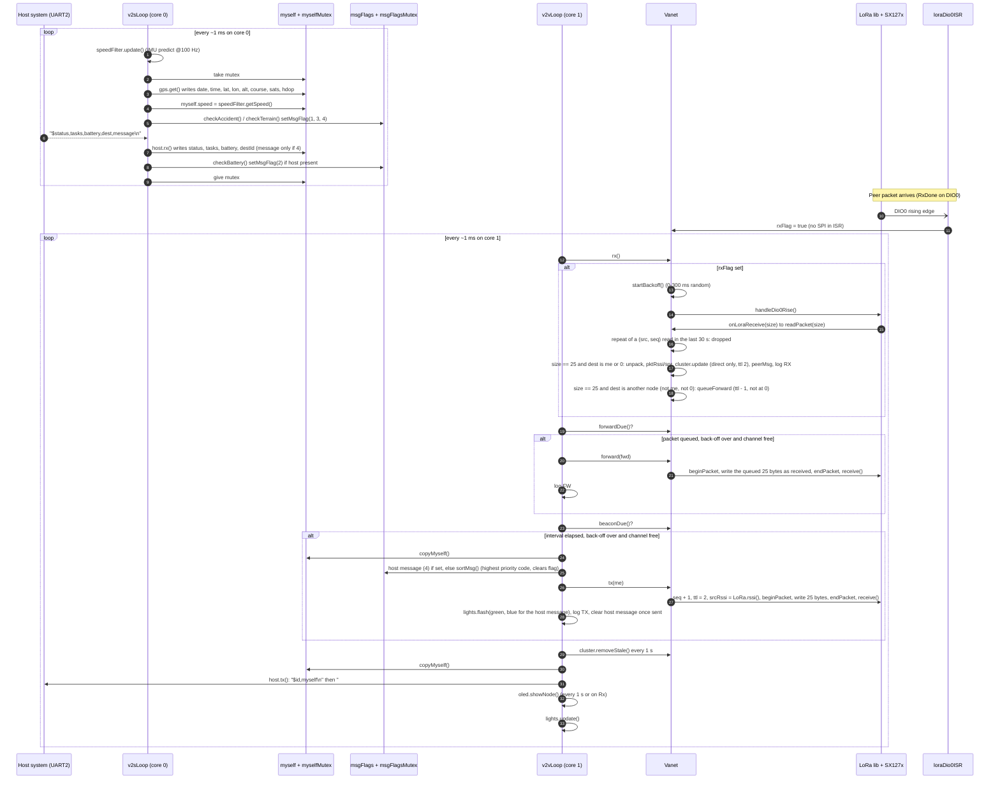
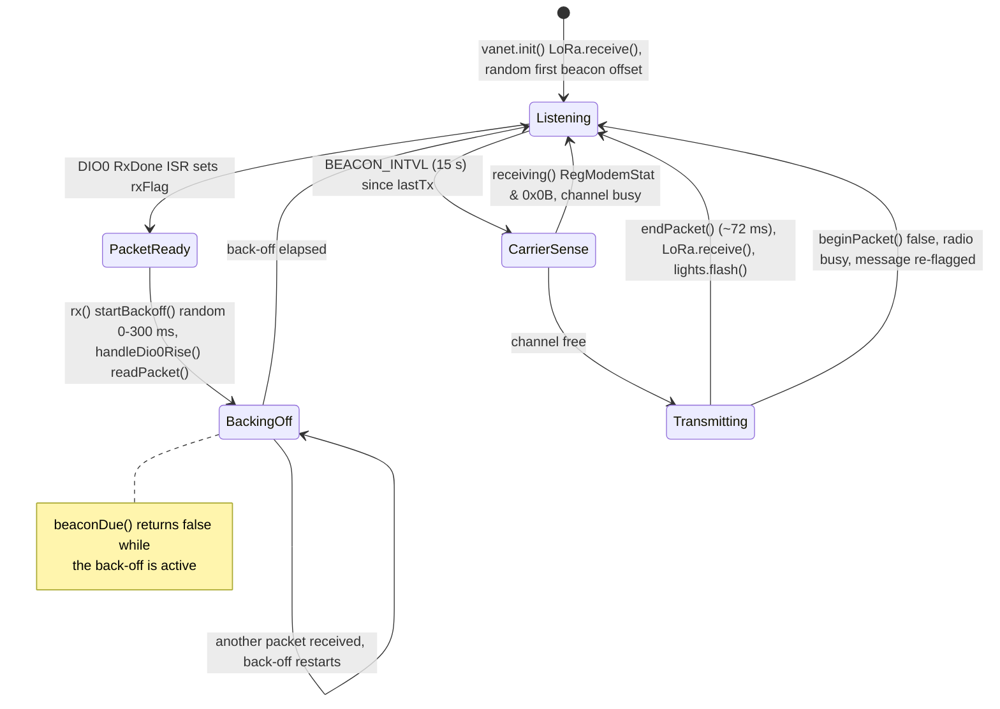
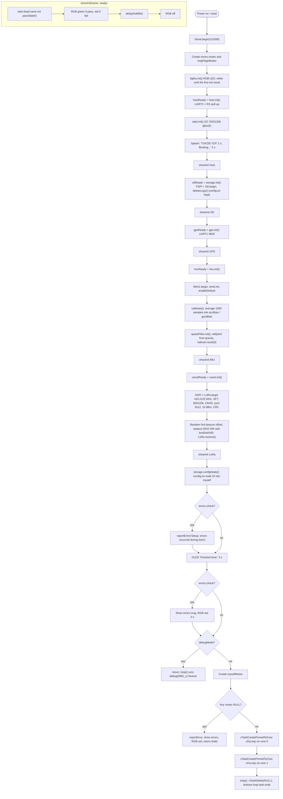
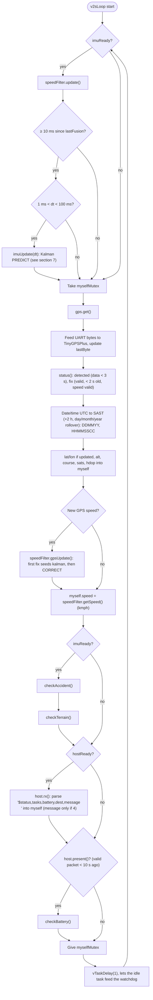
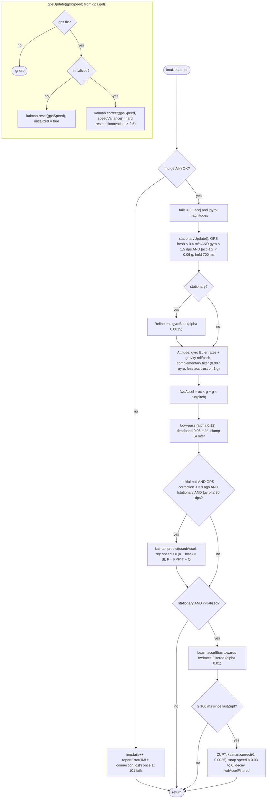
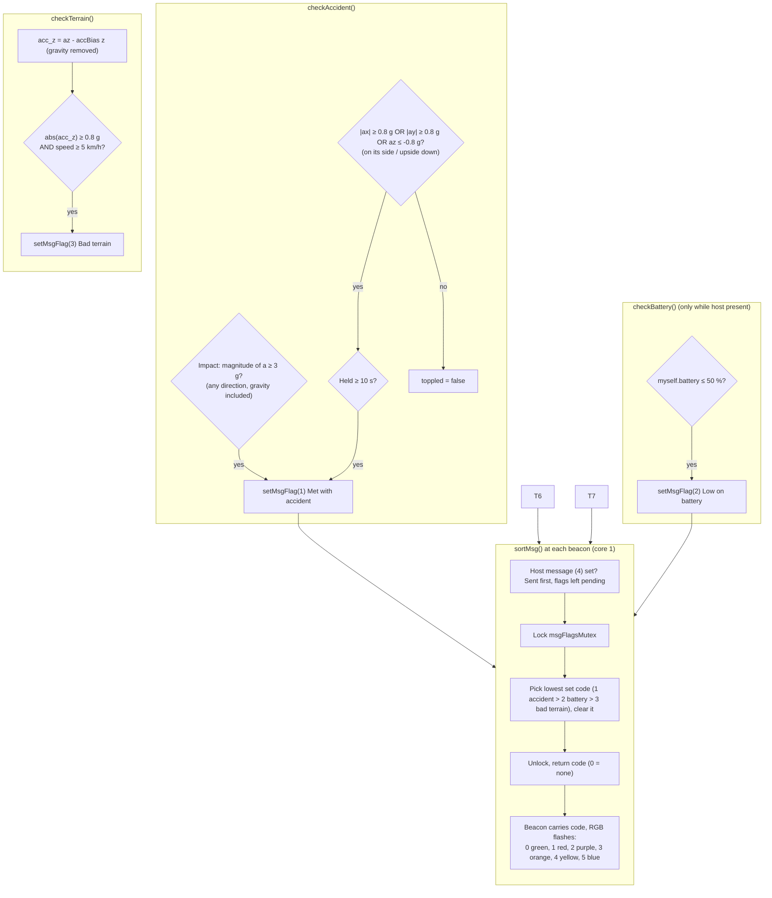
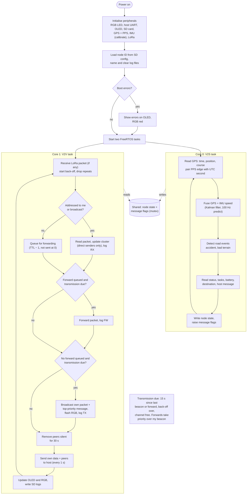

# TVV Node Firmware: UML and Flow Diagrams

Diagrams of the node firmware in `src/` and `include/` (ESP32-S3, Arduino + FreeRTOS). They are written in Mermaid, which GitHub and VS Code (with a Mermaid extension) render.

1. [UML class diagram](#1-uml-class-diagram): structs, modules, global instances and libraries
2. [UML sequence diagram](#2-uml-sequence-diagram-dual-core-runtime): how the two cores, the radio and the host interact
3. [UML state diagram](#3-uml-state-diagram-vanet-mac-csmaca): VANET MAC (CSMA/CA)
4. [Flow: boot](#4-flow-boot-setup-and-loop): `setup()` and `loop()`
5. [Flow: sensing task](#5-flow-sensing-task-core-0): `v2sLoop()` on core 0
6. [Flow: network task](#6-flow-network-task-core-1): `v2vLoop()` on core 1
7. [Flow: speed fusion](#7-flow-speed-fusion-speedfilterimuupdate): `SpeedFilter::imuUpdate()`
8. [Flow: road awareness and messages](#8-flow-road-awareness-and-message-priority): `checkAccident()`, `checkTerrain()`, `checkBattery()`, `sortMsg()`
9. [Flow: overview](#9-flow-overview): simplified view of the whole firmware

---

## 1. UML class diagram

```mermaid
classDiagram
    direction TB

    %% ---------------- Core data (system.h / system.cpp) ----------------
    class Data {
        <<struct>>
        +byte destId
        +byte srcId
        +uint16_t seq
        +uint8_t ttl
        +int8_t srcRssi
        +float pktRssi
        +float snr
        +float freqErr
        +int64_t utc
        +uint32_t airUs
        +uint8_t sync
        +byte id
        +float lat
        +float lon
        +float alt
        +byte sats
        +float hdop
        +float speed
        +float course
        +uint8_t tasks
        +uint8_t status
        +uint8_t message
        +byte battery
        +uint32_t date
        +uint32_t time
        +toStr() String
    }

    class Errors {
        <<struct>>
        +bool check
        +String msg
        +SemaphoreHandle_t mutex
    }

    class SystemModule {
        <<module system.cpp>>
        +Data myself$
        +Errors errors$
        +reportError(text) void$
    }

    %% ---------------- VANET (vanet.h / vanet.cpp) ----------------
    class Packet {
        <<packed struct, 25 bytes>>
        +uint8_t dest
        +uint8_t src
        +uint16_t seq
        +uint8_t ttl
        +uint8_t message
        +uint32_t date
        +uint32_t time
        +int32_t lat
        +int32_t lon
        +uint8_t status
        +uint8_t tasks
        +uint8_t battery
        +pack(node) void
        +unpack(node) void
    }

    class Cluster {
        <<struct>>
        +Data peerTable[MAX_PEERS = 3]
        +uint8_t count
        +uint32_t lastHeard[MAX_PEERS]
        +uint32_t lastCheck
        +find(id) int
        +update(node) bool
        +removeStale() uint8_t
        +averageSnr() float
    }

    class Vanet {
        <<struct>>
        +SPIClass spi = HSPI
        +volatile bool rxFlag
        +bool rxValid
        +uint8_t peerMsg
        +uint8_t peerMsgId
        +uint8_t lastMsg
        +uint16_t txSeq
        +int8_t txRssi
        +uint32_t lastTx
        +uint32_t backoffStart
        +uint32_t backoffMs
        +Data rxBuffer
        +Cluster cluster
        +init() bool
        +rx() bool
        +readPacket(size) void
        +queueForward(pkt) void
        +forwardDue() bool
        +forward(node) bool
        +clearBuffer() void
        +startBackoff() void
        +backoffActive() bool
        +receiving() bool
        +beaconDue() bool
        +tx(node) bool
    }

    class VanetCallbacks {
        <<module vanet.cpp>>
        +loraDio0ISR() void$
        +onLoraReceive(size) void$
    }

    %% ---------------- Sensing (sensing.h / sensing.cpp) ----------------
    class UtcClock {
        <<struct>>
        +volatile int64_t ppsUs
        +int64_t anchorUs
        +int64_t anchorUtc
        +double rate
        +pair(utcSecond) void
        +toUtc(localUs, sync) int64_t
    }

    class GPS {
        <<struct>>
        +HardwareSerial uart = UART1
        +TinyGPSPlus tinyGps
        +int32_t lastUtcSecond
        +bool detected
        +bool fix
        +float lastSpeed
        +uint32_t lastSample
        +uint32_t lastByte
        +init() bool
        +get() void
        +status() void
        +speedVariance() float
        +toStr(out, cap) size_t
    }

    class IMU {
        <<struct>>
        +LSM6 lsm6
        +uint16_t fails
        +float accBias[3]
        +float gyroBias[3]
        +float acc[3]
        +float gyro[3]
        +uint32_t lastSample
        +init() bool
        +calibrate() bool
        +get(reading, axis, calibrated, scaled) float
        +getAll() bool
        +toStr(out, cap) size_t
    }

    class KalmanFilter {
        <<struct>>
        +float speed
        +float accelBias
        +float P00
        +float P01
        +float P10
        +float P11
        +reset(initialSpeed) void
        +predict(acceleration, dt) void
        +correct(measuredSpeed, measurementVariance, allowHardReset) void
    }

    class SpeedFilter {
        <<struct>>
        +KalmanFilter kalman
        +bool initialized
        +bool stationary
        +uint32_t stationaryStart
        +float roll
        +float pitch
        +float fwdAccelFiltered
        +uint32_t lastGpsCorrection
        +uint32_t lastZupt
        +uint32_t lastFusion
        +init() void
        +gpsUpdate(gpsSpeed) void
        +stationaryUpdate(accMagnitude, gyroMagnitude) void
        +imuUpdate(dt) void
        +update() void
        +getSpeed() float
    }

    %% ---------------- Interpret (interpret.h / interpret.cpp) ----------------
    class Interpret {
        <<module interpret.cpp>>
        +const char* codedMessages[MSG_COUNT]$
        +const uint8_t msgColours[MSG_COUNT]$
        +const char* codedStatus[STATUS_COUNT]$
        +SemaphoreHandle_t msgFlagsMutex$
        -bool msgFlags[MSG_COUNT]$
        +checkAccident() void$
        +checkTerrain() void$
        +checkBattery() void$
        +setMsgFlag(code) void$
        +sortMsg() uint8_t$
    }

    %% ---------------- Host (host.h / host.cpp) ----------------
    class Host {
        <<struct>>
        +HardwareSerial uart = UART2
        +uint32_t lastTx
        +uint32_t lastRx
        +char rxBuffer[MSG_SIZE]
        +uint8_t rxLen
        +bool inPacket
        +init() bool
        +tx(me, table, size) void
        +rx() bool
        +present() bool
    }

    %% ---------------- Storage (storage.h / storage.cpp) ----------------
    class Storage {
        <<struct>>
        +SPIClass spi = FSPI
        +bool ok
        +uint32_t lastWrite
        +uint32_t lastRead
        +uint32_t lastNodeLog
        +uint32_t lastSenseLog
        +init() bool
        +deleteLogs() void
        +configNode() String
        +read(file) String
        +write(content, file) void
        +formatSensing(node) String$
        +formatVanet(event, node) String$
        +formatMyself(node) String$
    }

    %% ---------------- UI (ui.h / ui.cpp) ----------------
    class OLED {
        <<struct>>
        +Adafruit_SSD1306 dev
        +bool ok
        +uint32_t lastShow
        +init() bool
        +centerText(text) void
        +disp(text, size, center, append) void
        +refresh() void
        +showNode(me) void
    }

    class SystemLights {
        <<struct>>
        +Adafruit_NeoPixel dev
        +uint8_t colour
        +bool flashing
        +uint32_t flashStart
        +init() bool
        +toggle(colour) void
        +flash(colour) void
        +update() void
    }

    %% ---------------- Main and debugging ----------------
    class Main {
        <<module main.cpp>>
        +bool debugMode$
        +bool hostReady$
        +bool sdReady$
        +bool gpsReady$
        +bool imuReady$
        +bool vanetReady$
        +TaskHandle_t v2sTask$
        +TaskHandle_t v2vTask$
        +SemaphoreHandle_t myselfMutex$
        +setup() void$
        +loop() void$
        +v2sLoop(param) void$
        +v2vLoop(param) void$
        +copyMyself() Data$
        +initStatus(name, ready) String$
        +showInit(name, ready, append, holdMs) void$
    }

    class Debugging {
        <<module debugging.cpp>>
        +debug(peripheral) void$
        +uiDebug() void$
        +storageDebug() void$
        +gpsDebug() void$
        +imuDebug() void$
        +hostDebug() void$
        +loraDebug(select) void$
    }

    %% ---------------- External libraries ----------------
    class LoRaClass {
        <<library, patched lib/LoRa>>
    }
    class TinyGPSPlus {
        <<library>>
    }
    class LSM6 {
        <<library>>
    }
    class Adafruit_SSD1306 {
        <<library>>
    }
    class Adafruit_NeoPixel {
        <<library>>
    }
    class SD {
        <<library>>
    }

    %% ---------------- Relationships ----------------
    SystemModule *-- "1 myself" Data
    SystemModule *-- "1" Errors

    Vanet *-- "1" Cluster
    Vanet *-- "1 rxBuffer" Data
    Cluster *-- "0..3 peers" Data
    Vanet ..> Packet : pack / unpack
    Packet ..> Data : converts
    Vanet ..> LoRaClass : SPI radio
    VanetCallbacks ..> Vanet : sets rxFlag / readPacket
    LoRaClass ..> VanetCallbacks : onReceive callback

    SpeedFilter *-- "1" KalmanFilter
    SpeedFilter ..> IMU : getAll, biases
    SpeedFilter ..> GPS : fix, lastSpeed
    GPS ..> SpeedFilter : gpsUpdate
    IMU ..> SpeedFilter : init after calibrate
    GPS *-- TinyGPSPlus
    IMU *-- LSM6
    GPS ..> Data : writes myself

    Interpret ..> IMU : reads acc, gyro
    Interpret ..> Data : reads myself.battery

    Host ..> Data : writes status, tasks, battery, destId, message
    Storage ..> Data : writes id
    Storage ..> SD

    OLED *-- Adafruit_SSD1306
    SystemLights *-- Adafruit_NeoPixel
    OLED ..> Vanet : cluster, peerMsg
    OLED ..> Host : present
    OLED ..> Interpret : codedStatus, codedMessages

    Main ..> Debugging : debugMode only
    note for Main "Uses every module: setup() inits each one,
v2sLoop() on core 0 and v2vLoop() on core 1 drive them"
```

Every struct has one global instance (`gps`, `imu`, `speedFilter`, `vanet`, `host`, `storage`, `oled`, `lights`). `myself : Data` is the node's own state, shared between the cores under `myselfMutex`. The non-struct source files are shown as `<<module>>` classes.

---

## 2. UML sequence diagram: dual-core runtime

After `setup()`, the work is split across two FreeRTOS tasks. Core 0 writes `myself`, and core 1 reads it through `copyMyself()`. Both lock `myselfMutex`. Message codes pass between the cores through `msgFlags`, which `msgFlagsMutex` protects.

---

## 3. UML state diagram: VANET MAC (CSMA/CA)

The radio stays in continuous Rx. `rx()` and `beaconDue()` run on every network loop pass, each on its own.

---

## 4. Flow: boot (`setup()` and `loop()`)

---

## 5. Flow: sensing task (core 0)

---

## 6. Flow: network task (core 1)

```mermaid
flowchart TD
    A([v2vLoop start]) --> B{"vanetReady?"}
    B -- no --> H

    B -- yes --> C["received = vanet.rx()"]
    C --> C1{"rxFlag?"}
    C1 -- no --> D
    C1 -- yes --> C2["rxFlag = false, startBackoff() random 0-300 ms"]
    C2 --> C3["LoRa.handleDio0Rise() then onLoraReceive(size) then readPacket(size)"]
    C3 --> C4{"size == 25 bytes?"}
    C4 -- no --> D
    C4 -- yes --> CD{"(src, seq) already read<br/>in the last 30 s?"}
    CD -- yes --> CD1["Drop the repeat"] --> D
    CD -- no --> CF{"dest is another node<br/>(not me, not 0)?"}
    CF -- yes --> CF1{"ttl - 1 > 0 AND<br/>queue not full?"}
    CF1 -- yes --> CF2["queueForward: ttl - 1, queued as received"] --> D
    CF1 -- no --> D
    CF -- no --> C5["Packet.unpack into rxBuffer, add pktRssi, snr, freqErr"]
    C5 --> CT{"ttl == 2?<br/>(heard straight from the sender)"}
    CT -- yes --> C6["cluster.update(rxBuffer): add or refresh peer (max 3)"] --> C7
    CT -- no --> C7["peerMsg / peerMsgId / peerMsgAt = sender's message"]
    C7 --> C8["storage.write(formatVanet('RX', rxBuffer), vanet_log{ID}.txt)"]
    C8 --> F0

    F0{"vanet.forwardDue()?<br/>packet queued AND<br/>back-off over AND<br/>!receiving()"}
    F0 -- yes --> F1["vanet.forward(fwd): send the oldest queued packet as received, receive()"]
    F1 --> F2["storage.write(formatVanet('FW', fwd), vanet_log{ID}.txt)"] --> D
    F0 -- no --> D

    D{"vanet.beaconDue()?<br/>≥ 2 s since lastTx AND<br/>back-off over AND<br/>!receiving()"}
    D -- no --> G
    D -- yes --> E["me = copyMyself(), me.message = 5 if the host set it, else sortMsg()"]
    E --> E1["vanet.tx(me): seq + 1, ttl = 2, srcRssi = LoRa.rssi(), Packet.pack, beginPacket, write 25 B, endPacket, receive()"]
    E1 --> E2{"Sent?"}
    E2 -- yes --> E3["lights.flash(green, or blue for the host message), 500 ms,<br/>log TX, clear the host message"]
    E2 -- no --> E4{"message != 0 AND not the host message?"}
    E4 -- yes --> E5["setMsgFlag(message), retry next beacon"]
    E4 -- no --> G
    E3 --> G
    E5 --> G

    G{"≥ 1 s since cluster.lastCheck?"}
    G -- yes --> G1["cluster.removeStale(): drop peers silent > 10 s"]
    G1 --> G2{"peerMsgId not in the cluster AND<br/>peerMsg older than 10 s?"}
    G2 -- yes --> G3["peerMsg = 0"] --> H
    G2 -- no --> H
    G -- no --> H

    H{"hostReady AND ≥ 1 s since host.lastTx?"}
    H -- yes --> H1["me = copyMyself(), me.message = vanet.lastMsg, me.seq = txSeq, me.srcRssi = txRssi"]
    H1 --> H2["host.tx(): '$id,myself\n' then '#id,peer\n' per cluster peer"]
    H2 --> I
    H -- no --> I

    I{"received OR ≥ 1 s since oled.lastShow?"}
    I -- yes --> I1["oled.showNode(copyMyself()): signal bars (average peer SNR), speed, battery, status, lat/lon, peers, latest peer message"]
    I1 --> J
    I -- no --> J["lights.setBackground(): red if detected(1), else purple if detected(2),<br/>else orange if detected(3) (each held 200 ms), else yellow without a GPS fix, else off; lights.update(): end the flash after 500 ms"]

    J --> K["Every 1 s: log myself_log{ID}.txt and sensor_log{ID}.txt"]
    K --> L["vTaskDelay(1)"]
    L --> B
```

---

## 7. Flow: speed fusion (`SpeedFilter::imuUpdate`)

The state is 2-D: x = [speed (m/s), forward accelerometer bias (m/s²)]. The IMU runs the predict step at 100 Hz. The GPS runs the correct step at about 1 Hz, and zero-velocity updates (ZUPT) also correct while the node is stopped.

---

## 8. Flow: road awareness and message priority

---

## 9. Flow: overview

A simplified view of the whole firmware: boot, then two tasks running in parallel, one per core. The V2S task (core 0) writes the node's own state (`myself`) and raises message flags; the V2V task (core 1) reads them. Both are protected by mutexes.

