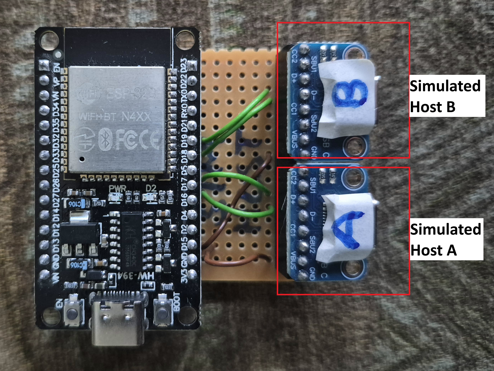
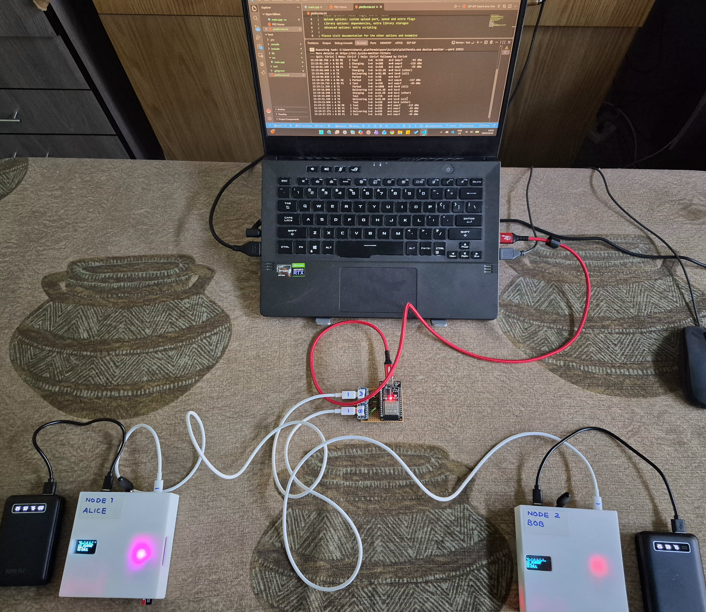

# TVV simulated host device (SHD)

Firmware for an ESP32 DevKit that stands in for the vehicle's onboard **host** (for example, the TUKZIE dashboard) while testing TVV nodes. One SHD simulates **two hosts**, A and B, each on its own UART, so it can drive two nodes at once. Each simulated host:

- sends the node a host packet every second, cycling through a set of test packets (every status, task count, battery level, destination and host message), and
- reads the node's bursts (the node itself, then each cluster peer) and prints the new ones to the Serial Monitor.

<p align="center"></p>

## Hardware

| Part | Notes |
|---|---|
| ESP32 DevKit (ESP32-D0WD, CH340 USB-UART) | Runs both hosts, powered and monitored over USB |
| 2 × USB-C breakout | Host A and host B, each connected to a node's USB-C host UART port with a USB-C cable |

| Host | UART | SHD RX (from node `HOST_TX`) | SHD TX (to node `HOST_RX`) |
|---|---|---|---|
| A | UART1 | GPIO16 | GPIO17 |
| B | UART2 | GPIO18 | GPIO19 |

The link is crossed over (TX to RX), at 115200 baud, 8N1, 3.3 V logic, with a common ground.

<p align="center"></p>

## Build, flash and monitor

Set `upload_port` and `monitor_port` in [`platformio.ini`](platformio.ini) to the DevKit's COM port (currently `COM15`), then from this folder:

```bash
pio run -e host -t upload
```

```bash
pio device monitor -e host
```

Connect the nodes and power them up. Each host learns its node's ID from the node's own packet, and prints it (`A node ID = 1`).

## What the hosts send

Host → node: `$status,tasks,battery,dest,message\n` (the format in the main [README](../../README.md#host-link-uart2-text)).

The test packets are in `hostTxMsgs` in [`src/main.cpp`](src/main.cpp). Together they cover every status, no and some tasks, a battery that is full, above, at and below the node's low-battery threshold (50 %), with decimals that round up and down, and every destination with and without a host message:

| `dest` | Meaning |
|---|---|
| `0` | Broadcast |
| `DEST_OTHER` | The node on the other host (its ID, once heard) |
| `3`, `7` | Absent nodes: the other node forwards each packet once, then it is dropped at ttl 0 |

- Both hosts work through one shuffled cycle of the packets, so each host sends every packet once per cycle and the two never send the same packet at once. Host B sends half a second after host A, and runs half a cycle behind it.
- Each packet is held for a random 1 to 15 s (`HOLD_RANDOM`, `HOLD_MIN_MS`, `HOLD_MAX_MS`), or `HOLD_MS` with `HOLD_RANDOM` set to `false`.
- The host message (`message` = 4) is only sent with the first packet of a hold, so the node broadcasts it once.
- A `DEST_OTHER` packet waits until the other node has been heard, and a packet is never addressed to the host's own node.

## Serial Monitor output

`DISPLAY_UART` selects which hosts' Rx is printed (1 = A, 2 = B, 3 = both), and `SHOW_TX` also prints each new packet sent. A burst is printed only when it holds something new (a new beacon from the node, a new or changed peer, or a peer that left), not the node's repeats every second. The monitor's `time` filter adds the timestamp:

```
15:19:00.766 > B RX ME    2 Taxi       t=6  b=33%    m=2 seq=7      -92 dBm
15:19:01.249 > A RX P1    2 Taxi       t=6  b=33%    m=2 seq=7      -65 dBm
15:19:02.840 > A TX         Charging   t=0  b=23.5%  m=0 to=2 (other)
```

| Column | Meaning |
|---|---|
| `A` / `B` | Simulated host |
| `RX` / `TX` | Received from the node / sent to the node |
| `ME` / `Pn` | The node itself / its cluster peer `n` |
| ID, status, `t=`, `b=`, `m=` | Node ID, status, tasks, battery and message code |
| `seq=` | The node's last beacon, or the peer's last packet the node received |
| dBm | The node's own channel RSSI (`ME`), or how strongly the node heard the peer (`Pn`) |
| `to=` | Destination of a sent packet: `(all)` = broadcast, `(other)` = the node on the other host |
